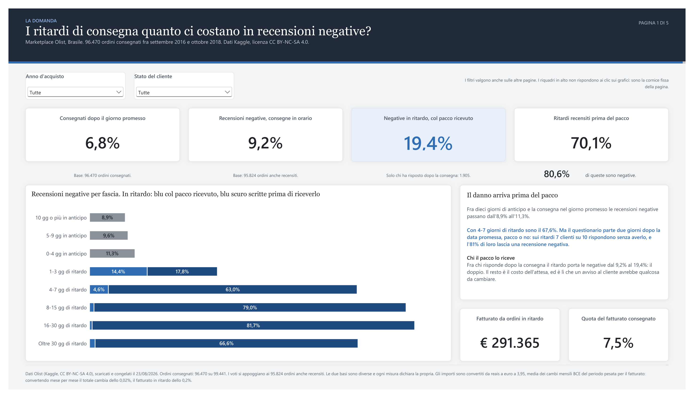
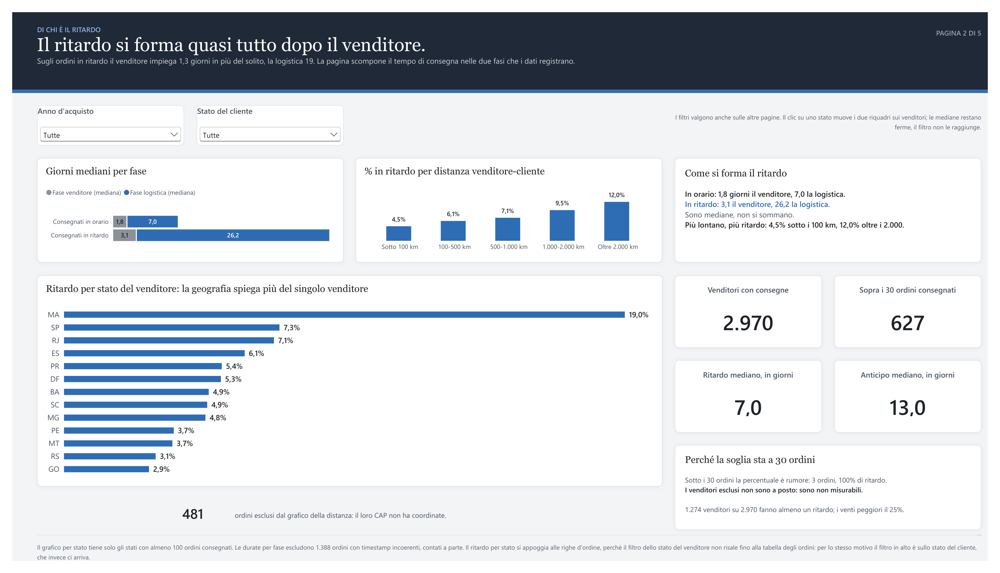
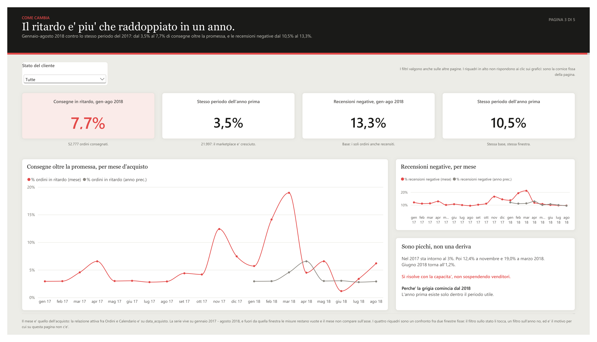
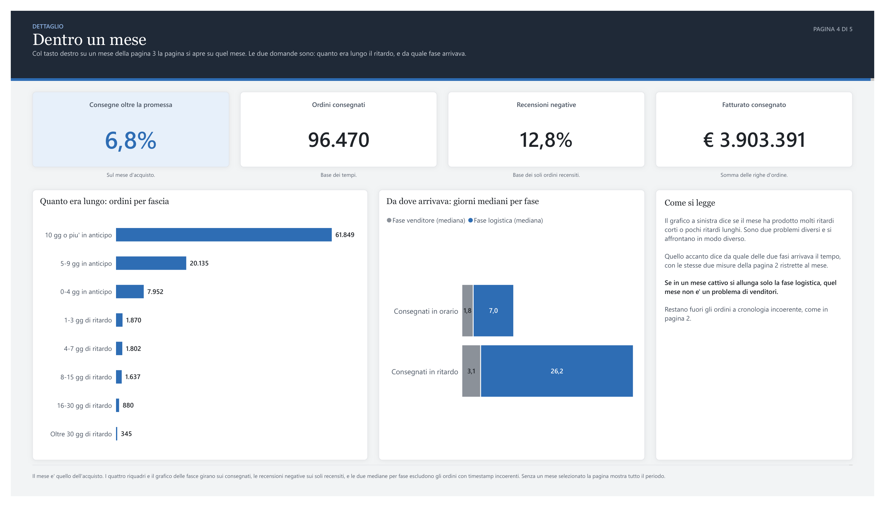
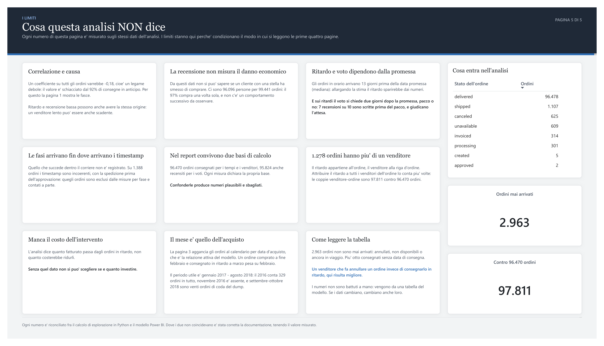
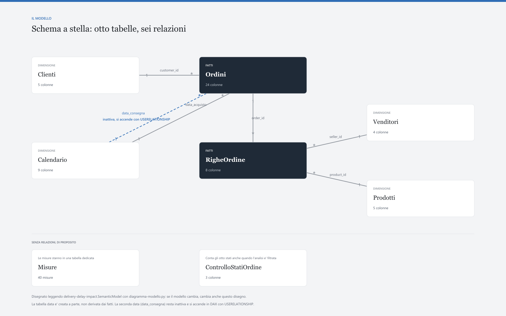

# Quanto costano i ritardi di consegna in recensioni negative

Report Power BI sui dati pubblici del marketplace brasiliano **Olist**: 96.470 ordini
consegnati tra settembre 2016 e ottobre 2018.

**Domanda:** gli ordini in ritardo generano più recensioni negative? E dove nasce il ritardo?

**Strumenti:** Power BI (DAX, Power Query), Python per generare e controllare il report.



---

## Risultati

- **La recensione arriva prima del pacco.** Il 6,8% degli ordini arriva dopo la data
  promessa. Su questi ordini il questionario parte comunque due giorni dopo quella data:
  7 clienti su 10 rispondono senza aver ancora ricevuto il pacco, e l'81% di loro lascia
  una recensione negativa.
- **Chi riceve il pacco in ritardo dà il doppio di recensioni negative:** 19,4% contro il
  9,2% di chi lo riceve in orario. La differenza resta anche confrontando ordini dello
  stesso stato o dello stesso mese.
- **L'effetto non è graduale, è a soglia.** Tra 10 giorni di anticipo e consegna puntuale
  le recensioni negative passano dall'8,9% all'11,3%. Con 4-7 giorni di ritardo salgono al
  67,6%. Per questo il report mostra fasce di ritardo e non una correlazione, che su tutti
  gli ordini varrebbe solo −0,18.
- **Il ritardo si accumula nel trasporto, non dal venditore.** Sugli ordini in ritardo la
  fase del venditore dura 1,3 giorni in più del solito, quella del corriere 19 (mediane).
  I 20 venditori con più ritardi hanno un tasso dell'8%, vicino al 6,7% generale.
- **Anche la distanza conta, ma non spiega tutto.** Fra venditore e cliente a meno di
  100 km arriva in ritardo il 4,5% degli ordini; oltre i 2.000 km il 12,0%. La distanza è
  in linea d'aria fra i centri dei CAP; 481 ordini restano fuori perché il CAP non ha
  coordinate.
- **Il problema cresce a picchi.** Per quasi tutto il 2017 i ritardi sono intorno al 3%,
  poi novembre 2017 arriva al 12,4% e marzo 2018 al 19,0%.

**Cosa ne ricavo:** un'ipotesi da verificare con chi gestisce le spedizioni. Più che
venditori da sospendere, sembra un problema di capacità nei mesi di punta. Avvisare il
cliente prima della data promessa potrebbe ridurre le recensioni scritte durante l'attesa.

**Cosa non dimostra:** la recensione misura la percezione del cliente, non il danno
economico; "in ritardo" vuol dire oltre la data promessa, non oltre un tempo ragionevole;
manca il costo per rimediare. L'ultima pagina del report elenca questi limiti.

---

## Le pagine del report

| | |
|---|---|
|  |  |
|  |  |

Dalla terza pagina, tasto destro su un mese per aprire il dettaglio (drill-through).
Passando il mouse su una fascia della prima pagina compare un tooltip con ordini, voto
medio e fatturato.

Versione PDF: [`schermate/delivery-delay-impact.pdf`](schermate/delivery-delay-impact.pdf)

---

## Il modello dati



Schema a stella: due tabelle dei fatti (ordine e riga d'ordine), quattro dimensioni, una
tabella delle misure (42 misure DAX).

Le scelte principali:

- **Due livelli di dettaglio.** Il fatturato sta nelle righe d'ordine, il ritardo negli
  ordini: ogni misura dichiara da quale tabella parte.
- **Recensioni pulite in Power Query.** 547 ordini hanno più recensioni e 789 `review_id`
  si ripetono su ordini diversi, quindi non sono una chiave valida. Il voto per ordine è
  una media; l'effetto sul voto medio è di 0,0005.
- **Calendario costruito a parte**, non ricavato dagli ordini: novembre 2016 non ha
  ordini e un calendario ricavato salterebbe quel mese.
- **Distanza calcolata in Power Query:** un punto per CAP (mediana delle coordinate, dopo
  aver tolto i punti fuori dal Brasile) e, per gli ordini con più venditori, il più lontano.
- **Soglie minime:** venditori sotto i 30 ordini e stati sotto i 100 esclusi dai confronti.
- **Importi in euro**, convertiti dai reais con la media dei cambi mensili BCE (3,95).

I problemi trovati nei dati e come li ho trattati sono in [`DATI-SPORCHI.md`](DATI-SPORCHI.md).

---

## Come è costruito

Il progetto è in formato `.pbip`: modello e report sono file di testo, versionati con Git
e generati da script.

| File | Cosa fa |
|---|---|
| `power-query/*.m` | le query, una per tabella |
| `costruisci-modello.ps1` | crea tabelle, relazioni e misure DAX |
| `costruisci-report.py` | crea le pagine del report |
| `verifica-tela.py` | otto controlli automatici: campi esistenti, niente sovrapposizioni, testo che entra nelle caselle |
| `diagramma-modello.py` | disegna il diagramma del modello |
| `leggi-misure.ps1` | legge i valori delle misure dal Power BI aperto, per confrontarli con quelli attesi |
| `tests/` | un test per ogni criterio di [`SPEC.md`](SPEC.md): numeri, distanza, report, README |

Cosa deve fare il report e come si controlla è scritto in [`SPEC.md`](SPEC.md) (requisiti e
criteri) e [`PIANO.md`](PIANO.md) (come è costruito). I numeri si ricontrollano due volte:
rifacendo i passaggi di Power Query in Python a partire dai CSV, e leggendoli dentro Power BI
con il report aperto.

Ho usato un assistente IA per scrivere gli script. La domanda, le scelte sul modello e la
verifica dei numeri sono mie, e sono spiegate in [`DOMANDA.md`](DOMANDA.md) e nei
commenti del codice.

### Riprodurlo

1. Scaricare il dataset [Brazilian E-Commerce di Olist](https://www.kaggle.com/datasets/olistbr/brazilian-ecommerce)
   (Kaggle, 164 MB) e scompattarlo in `dati_grezzi/csv/`.
2. Lanciare:
   ```
   powershell -ExecutionPolicy Bypass -File costruisci-modello.ps1
   python costruisci-report.py
   python verifica-tela.py
   ```
3. Aprire `delivery-delay-impact.pbip` con Power BI Desktop e aggiornare i dati.
4. Controllare tutto:
   ```
   pip install -r requirements-test.txt
   python -m pytest tests -v
   ```
   Senza i CSV i test sui numeri si saltano; senza Power BI aperto si salta il confronto
   con il motore.

---

## Altri documenti

| File | Contenuto |
|---|---|
| [`DOMANDA.md`](DOMANDA.md) | la domanda e le sei sotto-domande, scritte prima di aprire i dati |
| [`DATI-SPORCHI.md`](DATI-SPORCHI.md) | i problemi nei dati e come li ho risolti |
| [`RICONCILIAZIONE.md`](RICONCILIAZIONE.md) | i numeri che il report deve riprodurre, con l'esito del controllo |
| [`CHANGELOG.md`](CHANGELOG.md) | le correzioni fatte dopo la pubblicazione |

---

Dati: Olist su Kaggle, licenza CC BY-NC-SA 4.0, scaricati il 23 agosto 2026.
Cambi: BCE, serie `EXR.M.BRL.EUR.SP00.A`.
